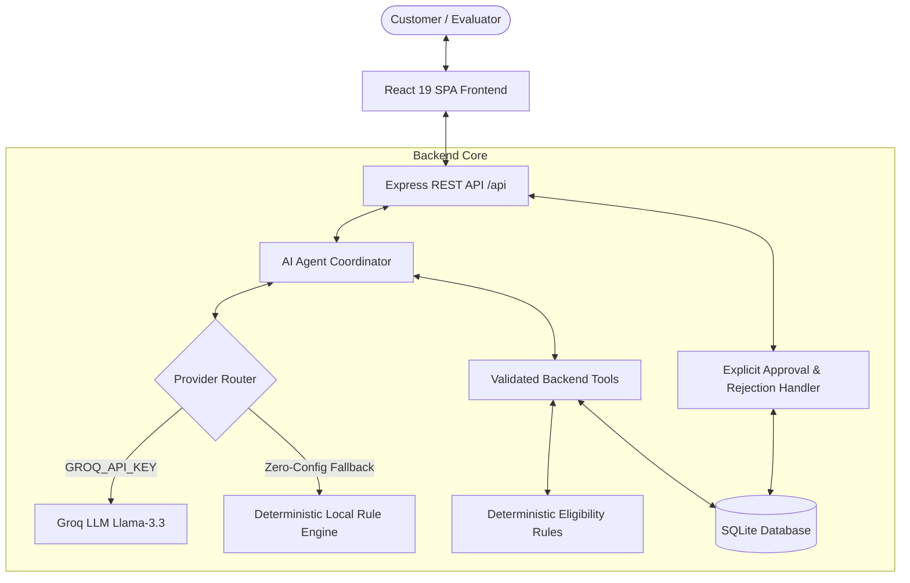

# ReturnRelay

> **AI-Powered Conversational Product Return and Warranty Resolution Agent**  
> *Simulated Alexa+ Experience for the Amazon Developer Relations: Build, Ship, Shape Hackathon*

[](https://www.typescriptlang.org/)
[](https://react.dev/)
[](https://expressjs.com/)
[](https://sqlite.org/)
[](https://vitest.dev/)
[](LICENSE)

---

## 1. Project Title
**ReturnRelay** — Conversational Product Return and Warranty Resolution Agent simulating an intelligent **Amazon Alexa+** proactive customer service experience.

---

## 2. Problem Statement
Post-purchase product returns, defect replacements, and manufacturer warranty resolutions are notorious pain points in online shopping:
- Customers must parse cryptic order histories, calculate confusing calendar cutoff dates, and locate buried serial numbers.
- Traditional customer support chatbots either answer questions using generic boilerplate text or hallucinate return policies that frustrate customers.
- Current automated return systems frequently execute irreversible actions (such as generating non-cancelable shipping labels or deducting return fees) without transparent explanations or explicit customer consent.

---

## 3. Proposed Solution
ReturnRelay transforms returns and warranty claims from a static form into an explainable, multi-step conversation:
1. Customers speak or type in natural language (*"My headphones stopped working. Can you help me return them?"*).
2. An AI agent coordinates server-side tools to find matching orders, disambiguate multiple purchases, and evaluate policies against a deterministic store calendar.
3. The agent prepares an actionable resolution case (e.g. standard refund return or manufacturer warranty replacement).
4. **Human-in-the-Loop Safeguard:** The agent never finalizes a consequential action automatically. Instead, it presents an inline authorization card and pauses for explicit customer review and approval.
5. All actions, calculations, and approvals are stored in an append-only audit trail in an SQLite database.

---

## 4. Target Users
- **Online Shoppers:** Seeking quick, stress-free return authorization or warranty replacements without waiting in customer support phone queues.
- **E-Commerce Merchants & Retailers:** Wanting to reduce support ticket overhead while maintaining strict adherence to return policies.
- **Customer Experience Designers & Developers:** Exploring how conversational AI and tool-calling agents can safely represent real business workflows.

---

## 5. Key Features
- **Conversational Natural Language Interface:** Chat with a simulated Alexa+ agent that maintains context and clarifies intent.
- **Multi-Step Tool Orchestration:** Real backend tools for finding orders, calculating eligibility, creating cases, querying statuses, and listing history.
- **Ambiguity Detection & Disambiguation:** Safely identifies when a query matches multiple products (e.g. NordicTrail boots vs. shoes) and asks for clarification instead of guessing.
- **Deterministic Business Rule Engine:** Return windows (30 days) and warranties (180–730 days) are computed from real calendar timestamps, preventing model hallucination.
- **Explicit Authorization Cards:** Actionable UI cards with explicit "Approve & Issue RMA" and "Reject Request" buttons that trigger atomic backend transactions.
- **Duplicate Action Prevention:** Protects against accidental multiple approvals or duplicate case submissions.
- **Visual Tool Traces:** Expandable accordion showing exact inputs, outputs, and execution timestamps for every tool invoked.
- **Multi-Provider Fallback:** Native support for Groq (`llama-3.3-70b-versatile`) and a built-in Local Rule Engine that runs with zero API keys required.

---

## 6. Why the Solution is Agentic Rather than a Simple Chatbot
A standard chatbot is a single-turn question-answering system that produces unverified text based on language model probabilities. In contrast, **ReturnRelay is a true agentic workflow**:
1. **Multi-Turn Planning:** The agent decides what steps are required based on user input (Search $\rightarrow$ Inspect $\rightarrow$ Calculate $\rightarrow$ Prepare $\rightarrow$ Await Approval).
2. **Tool Execution:** It issues structured tool calls to the backend, waits for JSON responses, and reasons over the result before generating customer responses.
3. **Hard Invariants & Separation of Concerns:** Business logic (eligibility, dates, policy checks) lives strictly in deterministic TypeScript code on the backend. The model cannot invent eligibility.
4. **Stateful Persistence:** Decisions change the database state (from `pending_approval` to `approved`), create Return Merchandise Authorizations (RMAs), and log immutable audit events.

---

## 7. Technology Stack
- **Frontend:** React 19, Vite 8, TypeScript, Tailwind CSS, Lucide Icons
- **Backend:** Node.js 22, Express, TypeScript (`tsx` runner), REST API
- **Database:** SQLite via Node 22 native `DatabaseSync` (`data/returnrelay.sqlite`)
- **Validation:** Zod schemas for all tool parameters and HTTP payloads
- **AI Tool Integration:** Official Groq SDK (`groq-sdk`) and fallback Local Agentic Engine
- **Testing:** Vitest automated test suite (14 passing tests)

---

## 8. Architecture Diagram



---

## 9. How the AI Tool-Calling Workflow Operates

When a user submits a message, the server executes a structured tool loop:
1. **Message Dispatch:** The message and tool definitions (`find_order`, `check_eligibility`, `create_case`, `get_case_status`, `list_orders`, `list_cases`) are forwarded to the active AI provider.
2. **Model Reasoning & Tool Calls:** The model inspects the request and responds with one or more tool calls.
3. **Zod Validation:** The server validates every argument against strict schemas.
4. **Backend Execution:** The backend runs the validated tool against the SQLite database and policy engine.
5. **Observation Loop:** Results are serialized as JSON and sent back to the model as `tool` observations.
6. **Continuation & Termination:** The model synthesizes the findings into friendly customer prose, surfaces the pending approval data, and completes the turn.

---

## 10. Database Structure
The SQLite database stores three primary tables:

### `orders` Table
- `id` (TEXT PRIMARY KEY) — e.g. `ORD-84920`
- `customer_name`, `customer_email` — Customer identification
- `product_name`, `product_category`, `product_sku` — Item metadata
- `price_cents`, `currency` — Price in cents (e.g. `19999` for `$199.99`)
- `purchase_date`, `delivery_date` — ISO dates (`YYYY-MM-DD`)
- `order_status` — `delivered`, `shipped`, or `processing`
- `return_window_days` — Standard return period (e.g. 30 days)
- `warranty_window_days` — Warranty coverage (e.g. 365 or 730 days)
- `policy_notes` — Detailed policy rules for demonstration

### `cases` Table
- `id` (TEXT PRIMARY KEY) — e.g. `CASE-2026-1001`
- `order_id` (TEXT) — Foreign key to orders
- `case_type` — `return`, `warranty_replacement`, or `warranty_repair`
- `issue_description` — Customer explanation
- `eligibility_decision` — `eligible`, `ineligible`, or `conditional`
- `policy_reason` — Explanation from eligibility engine
- `status` — `pending_approval`, `approved`, or `rejected`
- `proposed_action` — Proposed RMA resolution
- `resolution_details` — Final outcome & RMA code

### `case_events` Table (Audit Log)
- `id` (INTEGER PRIMARY KEY AUTOINCREMENT)
- `case_id` (TEXT)
- `event_type` — `case_prepared`, `user_approved`, `user_rejected`, `status_queried`, `system_reset`
- `actor` — `agent`, `user`, or `system`
- `summary` — Human-readable description
- `metadata_json` — Structured audit metadata
- `created_at` — Timestamp

---

## 11. Security Design
- **Server-Side API Keys:** Groq and Gemini API keys remain strictly on the server and are never bundled into the client build.
- **No Mock Bypasses:** Ordinary chat messages cannot approve or reject a case. Approval requires an explicit HTTP POST to `/api/cases/:id/approve`.
- **Atomic Operations:** Status transitions check current state to prevent duplicate approvals.
- **Input Sanitization:** All incoming requests are validated with Zod.
- **No Private Data Leaks:** Error handlers return clean JSON messages and suppress server stack traces.

---

## 12. Installation Instructions for Windows

Follow these exact steps in Windows PowerShell or Command Prompt:

### 1. Prerequisites
- **Node.js 20 or 22+** installed: [nodejs.org](https://nodejs.org/)
- **Git** installed: [git-scm.com](https://git-scm.com/)

### 2. Clone the Repository
```powershell
git clone https://github.com/your-username/returnrelay.git
cd returnrelay
```

### 3. Install Dependencies
```powershell
npm install
```

### 4. Configure Environment
Copy the example environment file:
```powershell
copy .env.example .env
```
*(Optional)* Open `.env` in Notepad and add your Groq API key:
```ini
GROQ_API_KEY="gsk_your_groq_api_key_here"
GROQ_MODEL="llama-3.3-70b-versatile"
```
*Note: If no API key is provided, ReturnRelay will automatically use its built-in Local Rule Engine so the application functions 100% out of the box!*

---

## 13. Required Environment Variables

| Variable | Description | Default | Required? |
| :--- | :--- | :--- | :--- |
| `GROQ_API_KEY` | Groq Cloud API Key for Llama-3.3 model inference | None | Optional (uses local agent if omitted) |
| `GROQ_MODEL` | Groq model identifier with function calling | `llama-3.3-70b-versatile` | Optional |
| `PORT` | Server listening port | `3000` | Optional |
| `RETURNRELAY_DEMO_DATE` | Fixed application calendar clock for deterministic tests | `2026-10-22` | Optional |

---

## 14. How to Run the Frontend and Backend

ReturnRelay uses a unified server architecture where Express runs the REST API and mounts Vite middleware for the frontend on port 3000.

### Start Development Server:
```powershell
npm run dev
```
Open your browser at: **`http://localhost:3000`**

### Build and Start for Production:
```powershell
npm run build
npm start
```

---

## 15. How to Run Tests

Run the full automated test suite using Vitest:
```powershell
npm test
```

### Expected Output:
```text
✓ tests/backend.test.ts (14 tests) 76ms
  ✓ successfully finds an existing order by exact ID
  ✓ successfully searches orders by keyword
  ✓ handles search failure gracefully for non-existent order
  ✓ detects ambiguity when multiple similar orders match
  ✓ correctly calculates days between dates
  ✓ evaluates inside-window return eligibility correctly (ORD-84920)
  ✓ evaluates return expired but warranty active (ORD-71932 Coffee Maker)
  ✓ evaluates completely ineligible item (ORD-58210 Desk Fan)
  ✓ creates a case with status pending_approval for eligible order
  ✓ prevents case creation for ineligible product under demo policy
  ✓ approves a pending case and records audit event
  ✓ rejects a pending case properly
  ✓ retrieves saved status and history via get_case_status tool
  ✓ rejects invalid tool arguments cleanly

Test Files  1 passed (1)
     Tests  14 passed (14)
```

Run TypeScript verification:
```powershell
npm run lint
```

---

## 16. Demo Credentials & Demo Setup
- **No user account or password is required.**
- The application automatically pre-populates a simulated demo profile (**Alex Morgan**) with 6 diverse orders across Electronics, Kitchen, Footwear, Smart Home, and Appliances.
- To reset the data at any time, click **Reset Demo** in the top navigation bar.

---

## 17. Known Limitations
- **Simulated Alexa+ Environment:** Runs as a web application prototype rather than a deployed physical Alexa voice skill.
- **Session Memory:** Conversation context is maintained within the active browser session. Long-term cross-session conversational memory across different days is not implemented.
- **Single Currency:** Order values and refunds are formatted in USD ($).

---

## 18. Simulated Data and Transaction Disclaimer
> **Important Disclaimer:**  
> All orders, customer accounts, return labels, RMA codes, and monetary values in ReturnRelay are **100% simulated demonstration data**. ReturnRelay does not execute real retail purchases, real banking transactions, real carrier shipments, or real retailer API calls.

---

## 19. Future Improvements
- **Voice Input & TTS:** Integrate Web Speech API or Alexa Voice Service for real-time acoustic speech input.
- **Photo Damage Inspection:** Add computer vision to inspect customer photos of damaged items before authorizing returns.
- **Automated Carrier API Integration:** Generate real UPS/FedEx QR return codes in production environments.
- **Multi-Tenant Retailer Portals:** Allow merchants to configure their own custom return windows and warranty terms.

---

## 20. Hackathon Demo Instructions

For judges and evaluators, use the built-in **Demo Guide** in the top bar or follow this rapid 3-minute sequence:

1. **Open the App:** Navigate to `http://localhost:3000`. Confirm clock is set to `2026-10-22`.
2. **Review Orders:** Click **Simulated Orders** and view `ORD-84920` (ApexSound Headphones).
3. **Initiate Return:** In the **Alexa+ Assistant** tab, send:
   ```text
   My headphones stopped working. Can you help me return them?
   ```
4. **Inspect Tool Traces:** Expand the tool accordion to view `find_order` and `check_eligibility`.
5. **Review Approval Card:** Observe Case `CASE-2026-1001` in `pending_approval` status.
6. **Approve:** Click **Approve & Issue RMA**. Notice immediate state update and generated tracking RMA code.
7. **Query Status:** Ask:
   ```text
   What is the status of CASE-2026-1001?
   ```
8. **Inspect Audit History:** Switch to **Activity Audit** to view the tamper-evident log.
9. **Test Ambiguity:** Ask:
   ```text
   I have an issue with my NordicTrail footwear and want to exchange it.
   ```
   Notice the agent identifies 2 candidate orders and requests clarification.
10. **Test Ineligible Return:** Ask:
    ```text
    I want to return the AeroBreeze desk fan that stopped spinning.
    ```
    Notice the agent explains that both return and warranty windows have elapsed.
