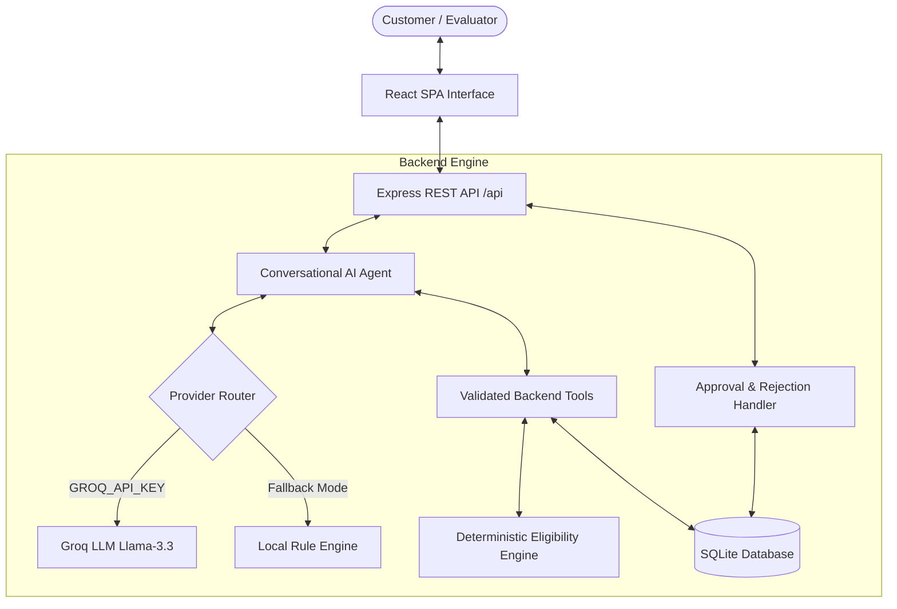
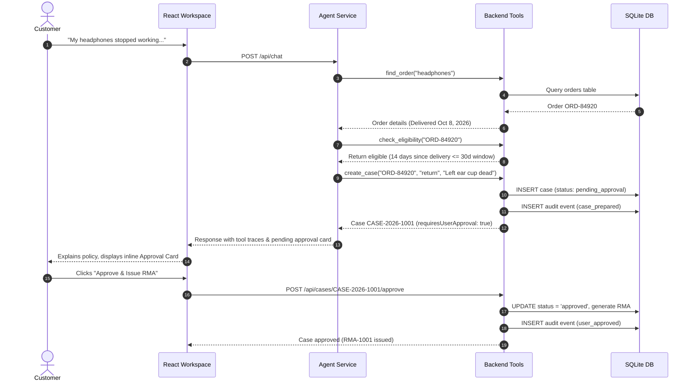

# ReturnRelay Architecture & Design

## 1. System Overview

ReturnRelay is an agentic resolution platform designed to simulate an Amazon Alexa+ proactive customer service experience. Rather than serving as a simple conversational chatbot that generates ungrounded answers, ReturnRelay couples a conversational reasoning loop with deterministic backend business logic and explicit human-in-the-loop authorization.

---

## 2. Agentic Tool Workflow & Safety Guardrails

### A. The Tool-Calling Loop
When a customer sends a message (e.g. *"My headphones stopped working. Can you help me return them?"*), the agent coordinates a multi-turn workflow:

### B. Core Guardrails
1. **Never Let the Model Guess Policies**: Eligibility is calculated by pure TypeScript functions in `src/server/eligibility.ts` based on fixed calendar dates (`calculateDaysBetween`). The model has no power to invent or override return dates.
2. **Ambiguity Prevention**: When a user mentions a product that matches multiple orders (e.g., `NordicTrail`), `find_order` returns `ambiguous: true` with all candidates. The agent is strictly instructed to seek customer clarification rather than picking one arbitrarily.
3. **Pending Approval Invariant**: The tool `create_case` will **only** insert records with `status = 'pending_approval'`. It cannot approve cases. Real database approval requires an explicit HTTP POST to `/api/cases/:id/approve` triggered by a physical user click.
4. **Duplicate Prevention**: If a case is already pending or approved for an order, re-invoking `create_case` identifies the existing case and returns its live status rather than polluting the database with duplicates.

---

## 3. Database Schema

ReturnRelay uses SQLite for persistent, deterministic data storage:

- **`orders`**: Stores simulated demo purchases with delivery dates, return window durations (e.g. 30 days), and warranty lengths (e.g. 365 or 730 days).
- **`cases`**: Stores prepared resolution actions, policy reasons, eligibility decisions, and approval statuses (`pending_approval`, `approved`, `rejected`).
- **`case_events`**: Append-only audit trail recording every state change, agent execution, user confirmation, or database reset.

---

## 4. Multi-Provider Fallback Architecture

To ensure ReturnRelay functions reliably across evaluation sandboxes without dependency on active paid external subscriptions:
1. **Groq Primary**: If `GROQ_API_KEY` is present, uses official `groq-sdk` with `llama-3.3-70b-versatile` function calling.
2. **Local Agentic Rule Engine**: If no API keys are provided or an external service suffers a rate limit, ReturnRelay executes an intelligent local rule-based agent loop that executes the exact same backend tools (`find_order`, `check_eligibility`, `create_case`, `get_case_status`) and produces genuine tool traces and approval cards!
